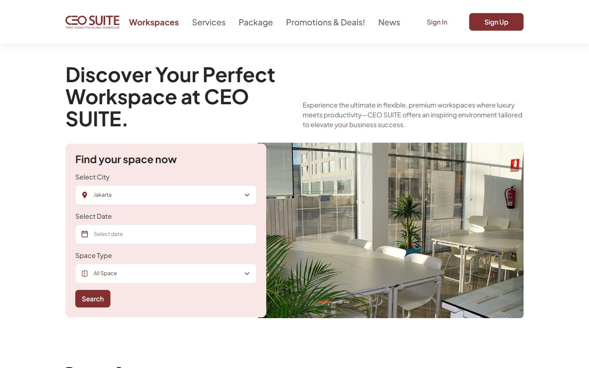
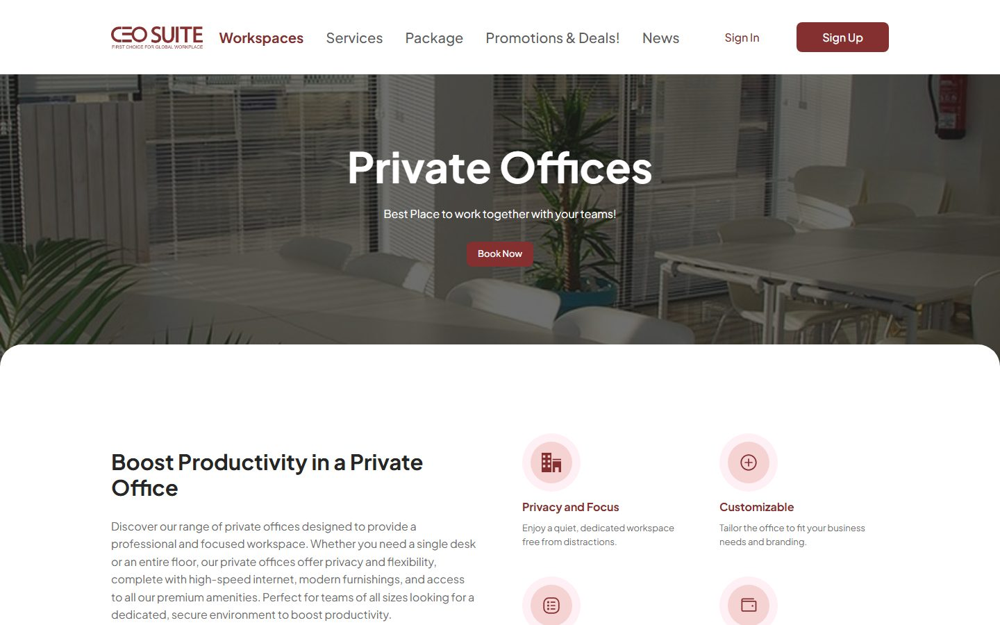
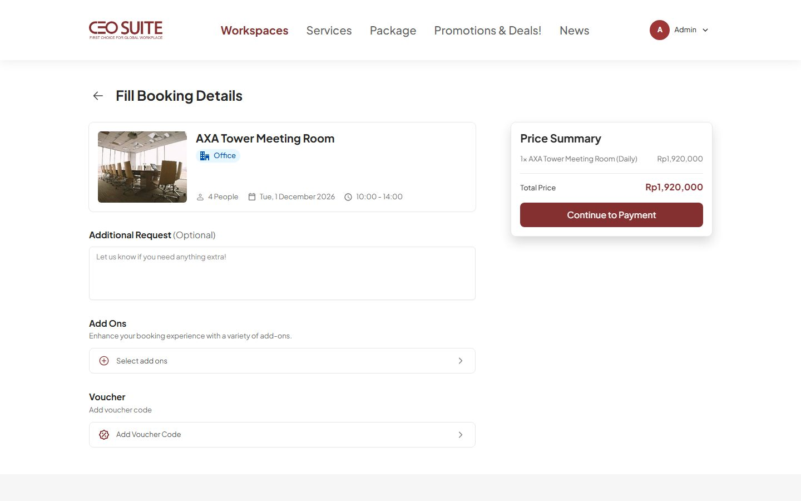
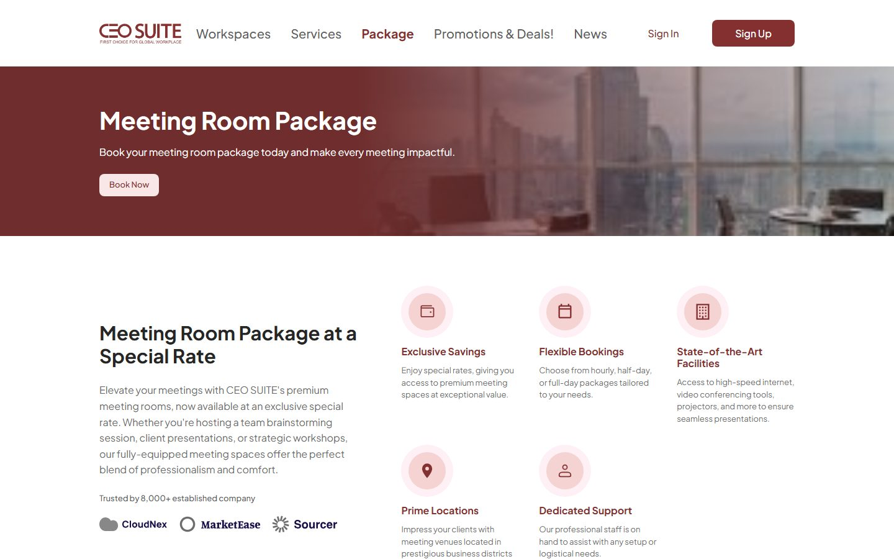
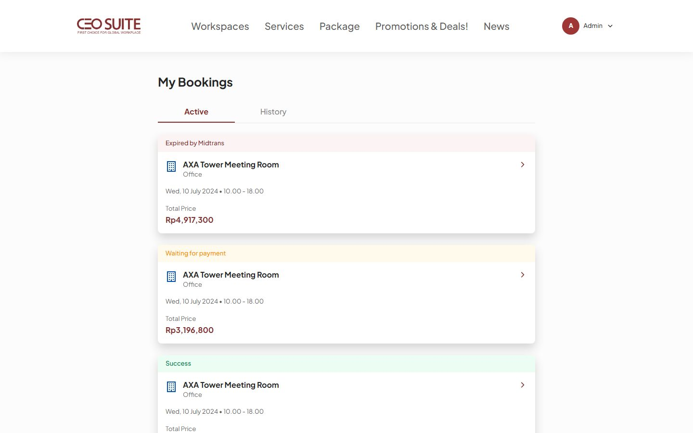
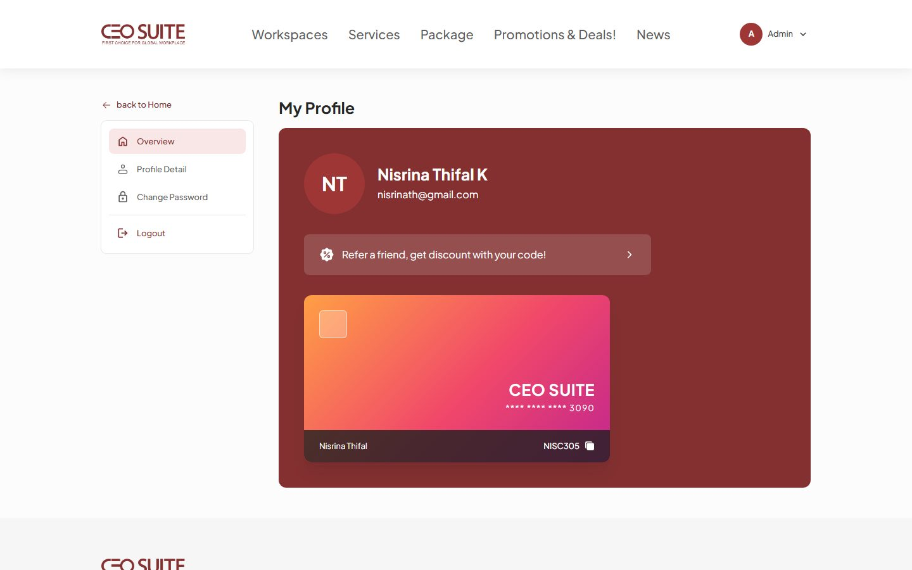

# CEO SUITE — Workspace Booking Web App

A front-end implementation of the **CEO SUITE** workspace booking website, built from the Figma design of the *Take Home Test*. Visitors can browse and search spaces, book meeting rooms and packages, read promotions and news, and manage their profile and bookings.

> There is no backend. All data is mocked on the client (see [Assumptions](#assumptions-and-decisions)).

- **Figma:** https://www.figma.com/design/5bxbVg27G3ZITjg2Sfwuiq/Take-Home-Test
- **Demo video:** https://youtu.be/M8YVhZDvlKU?si=-oW834Kkd-hj9DWX

## Screenshots

| Landing | Category listing | Fill booking details |
| --- | --- | --- |
|  |  |  |

| Meeting room package | My booking | Profile |
| --- | --- | --- |
|  |  |  |

More screenshots are in [`docs/screenshots`](docs/screenshots).

## Technologies Used

| Area | Technology |
| --- | --- |
| Framework | [Next.js 16](https://nextjs.org) (App Router) |
| UI | [React 19](https://react.dev) |
| Language | [TypeScript 5](https://www.typescriptlang.org) |
| Styling | [Tailwind CSS 4](https://tailwindcss.com) with design tokens in `src/app/globals.css` (`@theme`) |
| Forms and validation | [React Hook Form](https://react-hook-form.com) + [Zod 4](https://zod.dev) |
| Map | [Leaflet](https://leafletjs.com) (OpenStreetMap tiles) |
| Component docs and tests | [Storybook 10](https://storybook.js.org) + [Vitest 4](https://vitest.dev) + Playwright |
| Font | Plus Jakarta Sans via `next/font` |

## Getting Started

### Prerequisites

- **Node.js 20 or newer** (developed on Node 23)
- npm (a `package-lock.json` is included)

### Install and run

```bash
# 1. Install dependencies
npm install

# 2. Start the development server
npm run dev
```

Open [http://localhost:3000](http://localhost:3000).

### Other commands

| Command | What it does |
| --- | --- |
| `npm run dev` | Development server on port 3000 |
| `npm run build` | Production build |
| `npm run start` | Serve the production build (run `build` first) |
| `npm run storybook` | Component library on [http://localhost:6006](http://localhost:6006) |
| `npm run build-storybook` | Static Storybook build |
| `npx vitest run --project unit` | Unit tests (validation schemas) |
| `npx vitest run --project storybook` | Component tests from stories (needs Playwright browsers: `npx playwright install chromium`) |
| `npx tsc --noEmit` | Type check |

### Demo account

Authentication is mocked, so use these credentials to sign in:

| Email | Password |
| --- | --- |
| `admin@admin.com` | `admin123` |

Pages that require an account (Profile, My Booking, booking pages) show a "You're not Log in" state until you sign in. State is kept in your browser's `localStorage`. Clear site data to reset it.

## Features and Pages

| Page | Route | Notes |
| --- | --- | --- |
| Landing | `/` | Different hero for guests and signed-in users, recommended spaces, promos, partners, news, FAQ |
| Search results | `/search` | City, region, space type filters with a synced map |
| Category listing | `/category/[slug]` | Private offices, co-working, meeting rooms, event spaces, all spaces |
| Product detail | `/product/[id]` | Gallery, rates, date and time selection, location map |
| Room booking | `/booking/[id]` | Guest or signed-in flow, add-ons, voucher, terms, confirmation |
| Meeting room package | `/package` | Filters, search, pagination |
| Package booking | `/package/[id]/booking` | Voucher, price summary, confirmation |
| My booking | `/my-booking`, `/my-booking/[id]` | Active and history tabs, room and package detail |
| Promotions | `/promotions`, `/promotions/[id]` | Category tabs, carousels, promo code copy |
| Corporate partners | `/partners`, `/partners/[id]` | Pagination and detail |
| News | `/news`, `/news/[id]` | Category filter, related articles |
| Services | `/services` | Service cards and intro |
| Profile | `/profile`, `/profile/detail`, `/profile/password` | Member card, referral modal, inline editing, change password |
| Auth | `/login`, `/sign-up`, `/forgot-password`, `/verify-email` | Validated forms with mock verification |

## Project Structure

```text
src/
├── app/                    # Routes (App Router)
│   ├── (site)/             # Public site: landing, booking, profile, ...
│   ├── (auth)/             # Login, sign up, forgot password, verify email
│   └── globals.css         # Tailwind theme and design tokens
├── components/             # Atomic design
│   ├── atoms/              # Button, Input, Icon, Chip, Photo, ...
│   ├── molecules/          # Cards, form fields, tabs, pagination, ...
│   ├── organisms/          # Navbar, Footer, sections, forms, modals, ...
│   ├── templates/          # LandingLayout, AuthLayout
│   └── foundations/        # Colors, typography and icon stories
├── data/                   # Mock data per feature (no API)
└── lib/                    # Helpers, hooks (auth, bookings, profile), validations
public/                     # Images, icons, logos
docs/                       # Design system notes and screenshots
```

Every component has a Storybook story next to it (`Component.stories.tsx`).

## Assumptions and Decisions

- **No backend.** Data lives in `src/data`. Sign-in uses a hard-coded account in `src/lib/auth.ts`, and the signed-in state, bookings (`src/lib/my-bookings.ts`) and profile edits (`src/lib/use-profile.ts`) are stored in `localStorage`. Replacing these modules with API calls is the intended extension point.
- **Component reuse first.** New screens were assembled from existing atoms and molecules where possible. Shared pieces include `SearchResultsSection` (search and category pages), `PromoHero` (promotions, services, partners) and `ServiceIntroSection`.
- **Navigation without anchor tags.** Links are implemented with `onClick` handlers through the `useNavigate` hook and the `activateProps` helper (keyboard accessible: Enter activates, `role="link"`, focus ring), instead of `<a href>` or `next/link`.
- **Design tokens.** Colors, type scale, radii and shadows come from the Figma design system and are defined once in `globals.css`.
- **Responsive.** Layouts were checked at desktop widths and at 390 px mobile width (no horizontal overflow on the main pages).
- **Fill Booking Details for packages** follows the Figma frame (single centered column), unlike the room booking which uses a two-column layout.

## Known Limitations

- Several images are **placeholders** because the original Figma assets were not exported: the hero images of Partners, Package and category pages, the referral illustration, and profile photos.
- The "Contact Us" and "Learn More" buttons are intentionally not linked yet.
- Date filters do not change search results because there is no availability data.
- The bookings you create are stored only in your browser. The same booking will not appear on another device.
- Change password only validates and simulates success (no password is stored).
- Figma comparison was done visually and by measured layout values on key pages (Fill Booking Details, Category listing, Profile). Remaining pages were checked for structure and behaviour, not pixel by pixel.

## Testing

- **Unit tests:** `npx vitest run --project unit` covers the validation schemas.
- **Component tests:** each story is also a test through the Storybook Vitest addon (`--project storybook`).
- **End-to-end:** the main flows were exercised manually in a real browser against a production build: sign in, room booking, package booking, My Booking, profile editing and password change, category filters, and responsive widths. The recorded walkthrough is linked at the top of this file.
